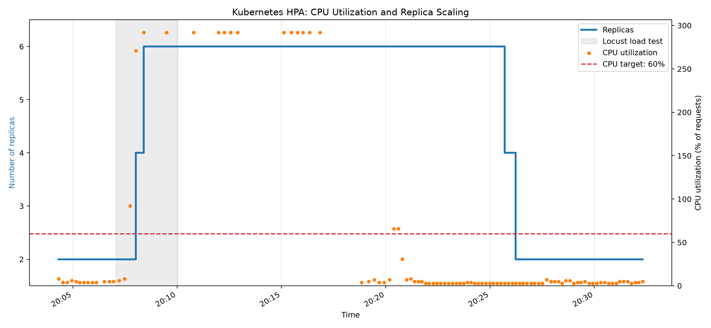

# Исправления по замечаниям к домашнему заданию № 3

**Дата:** 18 октября 2026 года  
**Репозиторий:** [mrpeet21/mlops-hw1](https://github.com/mrpeet21/mlops-hw1)  
**Ветка:** `fix/hw3-feedback`  
**Pull Request:** [#4 — Fix HW3 feedback: DVC, MLflow, HPA and CI validation](https://github.com/mrpeet21/mlops-hw1/pull/4)  
**Исходный отчёт:** [REPORT_3.md](REPORT_3.md)

## 1. Цель исправлений

После проверки домашнего задания № 3 были дополнены и перепроверены следующие части проекта:

1. Работа CI/CD и реальное развёртывание приложения в локальный кластер kind через self-hosted GitHub Actions runner.
2. Конфигурация `MODEL_ALIAS` и управление продвижением модели в MLflow Model Registry.
3. Версионирование данных через DVC: создание третьей версии, меняющей обучающую выборку, и сравнение результатов.
4. Практическое тестирование HPA под нагрузкой с сохранением метрик, событий Kubernetes и графика масштабирования.
5. Три контролируемых неуспешных CI-запуска, их диагностика и отдельные коммиты с исправлениями.

Данный файл **дополняет** первоначальный `REPORT_3.md`, не изменяя его историю. В нём разделены фактически проверенные результаты и ограничения выполненных экспериментов.

---

## 2. CI/CD: подтверждение deploy в локальный kind

### Замечание

В первоначальном отчёте раздел CI/CD остался незавершённым: отсутствовало подтверждение реального успешного развёртывания через self-hosted runner и ссылка на Pull Request.

### Что исправлено и проверено

Workflow [.github/workflows/ci.yml](.github/workflows/ci.yml) содержит три задачи:

| Задача | Среда выполнения | Условие запуска |
|---|---|---|
| `tests` | GitHub-hosted `ubuntu-latest` | Pull Request в `main` и push в `main` |
| `build` | GitHub-hosted `ubuntu-latest` | Успешный `tests` при push в `main` |
| `deploy` | Self-hosted runner с метками `[self-hosted, kind]` | Успешный `build` при push в `main` |

Подтверждена работа CI/CD с локальным кластером `mlops-hw1`. Во время успешного развёртывания проверялись:

- доступность локального kind из self-hosted runner;
- загрузка и развёртывание Docker-образа в kind;
- готовность Deployment и smoke-test через Traefik/Ingress;
- ответ `/health`, в том числе загруженная версия модели из MLflow Registry;
- успешный `POST /v1/predict`;
- запись запроса в PostgreSQL с соответствующим `request_id`.

Для повторяемого создания Kubernetes Secret применяется идемпотентная схема `kubectl create secret ... --dry-run=client -o yaml | kubectl apply -f -`.

**Доказательства:**

- [Успешный GitHub Actions run с `tests`, `build`, `deploy`](https://github.com/mrpeet21/mlops-hw1/actions/runs/37543017331).
- [Pull Request #3 — смерженный PR с CI/CD](https://github.com/mrpeet21/mlops-hw1/pull/3).

**Результат:** замечание об отсутствии рабочего deploy и оформленного PR устранено. Следующие эксперименты с конфигурацией проводились в отдельной ветке, без развёртывания намеренно ошибочных конфигураций в кластер.

---

## 3. MLflow: явное управление `champion` и `challenger`

### Замечание

Необходимо корректно использовать alias модели в конфигурации сервиса и сделать продвижение нового кандидата в production управляемым.

### Изменения

В [k8s/configmap.yaml](k8s/configmap.yaml) задано:

```yaml
MODEL_NAME: cancer-classifier
MODEL_ALIAS: champion
MLFLOW_TRACKING_URI: http://mlflow:5000
```

Таким образом, alias вынесен в конфигурацию развёртывания. Сервис использует текущий alias модели из Registry; для переключения версии не требуется пересборка образа. Механизм rollback через перенос alias ранее был продемонстрирован в исходном отчёте.

В [src/cancer_service/train.py](src/cancer_service/train.py) изменена логика регистрации моделей:

- каждая новая модель регистрируется в MLflow и получает alias `challenger`;
- прохождение model gate **само по себе не означает** переключения `champion`;
- перенос `champion` происходит только при одновременном выполнении model gate и передаче CLI-флага `--promote`;
- в метаданные сохраняются `gate_passed`, `promote_requested` и `promoted`.

Метрика model gate — `F1 malignant`, минимальный прирост — `MIN_GAIN = 0.01`.

### Проверка

Обучение на третьей версии данных было выполнено с `C=0.01` **без** `--promote`.

| Показатель | Результат |
|---|---|
| MLflow model | `cancer-classifier` |
| MLflow run ID | `c933bb7743914854a45be92b52c10b02` |
| Новая версия в текущем Registry | Version 2 |
| `F1 malignant` | 0.9032 |
| `data_md5` | `fb008922a1f8975d0f30f62898f3e2fb` |
| `challenger` | Version 2 |
| `champion` | Остался на Version 1 |

Model gate прошёл по сравнению с текущим `champion` (`F1 malignant` около 0.8649), однако без `--promote` производственная версия не изменилась.

**Важно:** напрямую сравнивать эти два значения F1 как эффект изменения **только датасета** некорректно: в отдельных обучающих запусках различались гиперпараметры и состав тестовой выборки. Для анализа влияния данных проведён отдельный эксперимент с одинаковыми условиями (следующий раздел).

---

## 4. DVC: новая версия данных и сравнение качества моделей

### Замечание

Вторая версия датасета содержала меньше столбцов, но не меняла строки и значения шести признаков, реально используемых при обучении. Требовалось показать изменение входных данных, способное повлиять на обучение, и сравнить результаты.

### Новая версия датасета

Из v2 сформирована v3 — стратифицированная выборка из 80% исходных объектов, с сохранением пропорций целевых классов. Использован фиксированный `random_state=42`.

| Версия | Размерность | DVC MD5 | Отличие |
|---|---|---|---|
| v1 | 569 × 31 | `5afc23b9622f8f9ffa60824f4e97d0d5` | Исходные данные |
| v2 | 569 × 7 | `6223e074879548a89f618a95238694e6` | 6 признаков и `target` |
| v3 | 456 × 7 | `fb008922a1f8975d0f30f62898f3e2fb` | Удалена часть объектов, изменён состав обучения |

В v3 осталось 456 объектов: 170 класса `malignant` и 286 класса `benign`. Новая версия была сохранена в DVC, выполнен `dvc push`; актуальный указатель хранится в [data/breast_cancer.csv.dvc](data/breast_cancer.csv.dvc).

### Контролируемый эксперимент

Подготовлен [scripts/compare_dvc_versions.py](scripts/compare_dvc_versions.py). Для моделей на v2 и v3 использованы:

- одинаковый алгоритм `StandardScaler + LogisticRegression`;
- одинаковые параметры `C=0.01`, `threshold=0.5`, `random_state=42`;
- **единый test set из 92 объектов**, присутствующих в обеих версиях;
- исключение всех тестовых объектов из обеих обучающих выборок.

| Метрика | v2 | v3 |
|---|---:|---:|
| Объектов при обучении | 477 | 364 |
| Объектов при тестировании | 92 | 92 |
| F1 malignant | 0.9032 | 0.9032 |
| Precision malignant | 1.0000 | 1.0000 |
| Recall malignant | 0.8235 | 0.8235 |
| ROC-AUC | 0.993408 | 0.993915 |
| Log Loss | 0.254701 | 0.273466 |
| Средняя P(benign) | 0.628213 | 0.620813 |

**Вывод.** Изменение обучающей выборки не привело к изменению F1 при данном пороге классификации. Однако предсказанные вероятности изменились: ROC-AUC немного выросла, а Log Loss ухудшился. Таким образом, новая версия данных оказывает влияние на модель, но **повышение качества не доказано**.

Для локального воспроизведения (при доступном DVC remote `../dvc-storage`):

```bash
uv run dvc get . data/breast_cancer.csv \
  --rev 28387ee \
  -o /tmp/breast_cancer_v2.csv

uv run python scripts/compare_dvc_versions.py
```

В команде `dvc get` используется конкретный Git-коммит исходной версии v2. Файл v3 берётся из текущего DVC checkout.

---

## 5. HPA: эксперимент с реальным масштабированием

### Настройки

В [k8s/hpa.yaml](k8s/hpa.yaml) задано:

```yaml
minReplicas: 2
maxReplicas: 6
# target CPU averageUtilization: 60
```

Ресурсные параметры приложения в [k8s/deployment.yaml](k8s/deployment.yaml):

```yaml
requests:
  cpu: "100m"
  memory: "256Mi"
limits:
  cpu: "500m"
  memory: "512Mi"
```

Нагрузка подавалась на `POST /v1/predict` через Traefik/Ingress (`cancer.localhost`). Для сбора данных использовались [locustfile.py](locustfile.py) и [scripts/monitor_hpa.py](scripts/monitor_hpa.py).

### Контролируемый прогон с мониторингом HPA

**Дата:** 18 октября 2026 года.  
**Locust:** 10 виртуальных пользователей, `spawn-rate=2` пользователя/с, запрошенная длительность 3 минуты.

| Показатель по Locust | Значение |
|---|---:|
| Завершённых запросов | 32 |
| Ошибок | 0 |
| Среднее время ответа | 6.98 с |
| p95 времени ответа | ≈ 22 с |
| Значение Requests/s в итоговом CSV | 1.24 |

Источник: [results/locust-hpa-10_stats.csv](results/locust-hpa-10_stats.csv). Значение `Requests/s` приведено как записано в Locust CSV, а не пересчитано делением количества запросов на три минуты.

Мониторинг HPA записал 109 наблюдений за период **20:04:19–20:32:19 (+03:00)**: [results/hpa-monitor.csv](results/hpa-monitor.csv).

| Время (+03:00) | Текущих Pod | Desired Pod | CPU HPA | Событие |
|---|---:|---:|---:|---|
| 20:04:19 | 2 | 2 | 8% | До нагрузки |
| 20:07:45 | 2 | 4 | 92% | Запрошено увеличение |
| 20:08:01 | 4 | 6 | 271% | Запрошено дальнейшее увеличение |
| 20:08:24 | 6 | 6 | 292% | Достигнут верхний предел |
| 20:25:31 | 6 | 4 | 3% | Началось снижение |
| 20:25:42 | 4 | 4 | 3% | Четыре реплики |
| 20:25:53 | 4 | 2 | 3% | Запрошен возврат к минимуму |
| 20:26:14 | 2 | 2 | 3% | Исходное состояние восстановлено |

**CPU HPA — это процент использования относительно `requests.cpu`, а не доля от физической мощности CPU**, поэтому значения могут превышать 100%.

Ожидаемое число реплик HPA в приближённом расчёте:

`desiredReplicas ≈ ceil(currentReplicas × currentCPU / targetCPU)`

Для 2 Pod при CPU = 92% и target = 60%: `ceil(2 × 92 / 60) = 4` — соответствует первому увеличению. При 4 Pod и CPU = 271% расчёт даёт больше 6, однако HPA ограничен `maxReplicas = 6`.

В Kubernetes были зафиксированы **четыре события `SuccessfulRescale`**, подтверждающие полный цикл **2 → 4 → 6 → 4 → 2**.



**Доказательства:**

- [Мониторинг HPA](results/hpa-monitor.csv).
- [События Kubernetes](results/hpa-final-events.yaml).
- [Вывод `kubectl describe hpa`](results/hpa-final-describe.txt).
- [График масштабирования](results/hpa-scaling.png).
- [Скрипт построения графика](scripts/plot_hpa.py).

### Задержка снижения числа Pod и проблемы измерений

После завершения нагрузки HPA не сразу уменьшил число Pod. На фоне нагрузки и после неё наблюдались временные ошибки Metrics API — `FailedGetResourceMetric` и `FailedComputeMetricsReplicas`. Максимальный наблюдавшийся разрыв между записями мониторинга составлял примерно 133 секунды.

На задержку могли повлиять как механизм стабилизации scale-down, так и нестабильность получения метрик. По имеющимся данным нельзя однозначно разделить их вклад. При этом факт последующего возвращения к двум Pod подтверждён наблюдениями и событиями Kubernetes.

### Другие нагрузочные тесты

Ранее выполнялись ещё три прогона Locust:

| Пользователей | Запросов | Ошибок | RPS из Locust | p95 |
|---|---:|---:|---:|---:|
| 20 | 156 | 0 | 2.55 | ≈ 42 с |
| 40 | 601 | 2 | 5.06 | ≈ 49 с |
| 60 | 402 | 89 | 1.66 | ≈ 113 с |

При 60 пользователях доля ошибочных запросов составила приблизительно **22.1%**. Среди ошибок наблюдались HTTP 502 и разрывы соединений — признаки перегрузки/нестабильности системы при более высокой интенсивности запросов.

**Ограничение:** во время этих трёх ранних прогонов не велась синхронная запись CPU и числа Pod, поэтому их нельзя считать тремя полностью документированными HPA-измерениями с CPU на каждую нагрузку. Синхронный график CPU и реплик получен для отдельного прогона на 10 пользователей.

**Память:** в начальном состоянии при двух Pod было около 179–182 MiB на Pod, на этапе увеличения нагрузки — около 192–194 MiB на ранее работающих Pod. Параметр `requests.memory = 256Mi` в рамках эксперимента не менялся; сравнение двух настроек memory requests до и после не проводилось.

---

## 6. Три намеренно красных запуска CI и их исправления

### Методика

В [tests/test_deployment_contracts.py](tests/test_deployment_contracts.py) добавлены три теста конфигурации:

- `test_model_alias`: проверяет допустимое значение `MODEL_ALIAS` для текущего production-окружения;
- `test_kind_cluster`: проверяет имя kind-кластера, которое использует workflow;
- `test_ingress_host`: проверяет, что host для smoke-test присутствует в `k8s/ingress.yaml`.

Эксперименты выполнялись в ветке `fix/hw3-feedback` при открытом [PR #4](https://github.com/mrpeet21/mlops-hw1/pull/4). Для каждого случая:

1. В конфигурацию вносилась одна намеренная ошибка.
2. Создавался отдельный коммит и выполнялся push.
3. В GitHub Actions фиксировался неуспешный `tests` job и сообщение Pytest.
4. Следующим отдельным коммитом конфигурация восстанавливалась.
5. Фиксировался новый успешный запуск `tests`.

Во всех трёх неуспешных прогонах Ruff прошёл, а Pytest показал **1 failed, 13 passed**. `build` и `deploy` были пропущены по условиям workflow, поскольку события являлись Pull Request, а не push в `main`.

### Таблица экспериментов

| № | Ошибка и диагностика | Красный CI | Зелёный CI после исправления |
|---|---|---|---|
| 1 | В ConfigMap `MODEL_ALIAS: nonexistent` вместо `champion`. Найдено несоответствие production alias. | [Run 39154143570](https://github.com/mrpeet21/mlops-hw1/actions/runs/39154143570) | [Run 39154584264](https://github.com/mrpeet21/mlops-hw1/actions/runs/39154584264) |
| 2 | В workflow `KIND_CLUSTER: wrong-cluster` вместо `mlops-hw1`. Найдено неверное имя кластера. | [Run 39155213829](https://github.com/mrpeet21/mlops-hw1/actions/runs/39155213829) | [Run 39155515769](https://github.com/mrpeet21/mlops-hw1/actions/runs/39155515769) |
| 3 | В workflow `INGRESS_HOST: wrong.localhost`, тогда как Ingress использует `cancer.localhost`. Найдено несовпадение host. | [Run 39155878698](https://github.com/mrpeet21/mlops-hw1/actions/runs/39155878698) | [Run 39156383939](https://github.com/mrpeet21/mlops-hw1/actions/runs/39156383939) |

Фрагменты логов трёх неуспешных проверок:

```text
AssertionError: Expected MODEL_ALIAS=champion, got nonexistent
AssertionError: Expected KIND_CLUSTER=mlops-hw1, got wrong-cluster
AssertionError: Ingress route for wrong.localhost not found
```

Изначально исправность всех новых тестов была зафиксирована в [зелёном Run 39153234699](https://github.com/mrpeet21/mlops-hw1/actions/runs/39153234699). В конце экспериментов все три ошибочных изменения были отменены; итоговый [Run 39156383939](https://github.com/mrpeet21/mlops-hw1/actions/runs/39156383939) успешен.

**Принципиальное ограничение:** полученные «красные» запуски — это **отказы статических тестов конфигурации на этапе PR**, а не настоящие runtime-ошибки запуска Pod, отсутствующего кластера на runner или неудачного smoke-test в `deploy`. Такой способ позволяет обнаруживать ошибочные настройки раньше и не нарушать работу локального kind-кластера, но не заменяет отдельное end-to-end негативное тестирование деплоя.

---

## 7. Итоги и ограничения

### Что удалось подтвердить

1. **CI/CD:** успешные тестирование, сборка и развёртывание в локальный kind через self-hosted runner; ссылки на рабочий GitHub Actions и PR приведены.
2. **MLflow:** новая версия модели назначается `challenger`; переход `champion` требует успешного gate и явного `--promote`.
3. **DVC:** добавлена третья версия с изменённым набором обучающих объектов, проведено сравнение двух датасетов без пересечения train и test.
4. **HPA:** получены график мониторинга и события `SuccessfulRescale`, подтверждающие масштабирование **2 → 4 → 6 → 4 → 2**.
5. **CI failures:** три отдельные ошибки конфигурации воспроизведены в GitHub Actions и исправлены; для каждого случая сохранены ссылки на красный и следующий зелёный запуск.

### Что не следует считать выполненным без дополнительных проверок

- Три ранних прогона Locust не имеют синхронных измерений CPU на Pod и количества реплик.
- Не выполнялся отдельный эксперимент по изменению `requests.memory` с замером «до/после».
- Не проверялись реальные аварийные сценарии непосредственно в self-hosted job `deploy` (ошибка загрузки модели в Pod, отсутствие кластера, падение Ingress smoke-test).
- Настройку approval для external contributors и остановку/удаление self-hosted runner после сдачи нужно подтвердить отдельно, если это требуется условиями задания.

Внесённые исправления находятся в [Pull Request #4](https://github.com/mrpeet21/mlops-hw1/pull/4). На момент подготовки отчёта последний запуск проверок в PR завершился успешно; сам PR ещё не был смержен.
